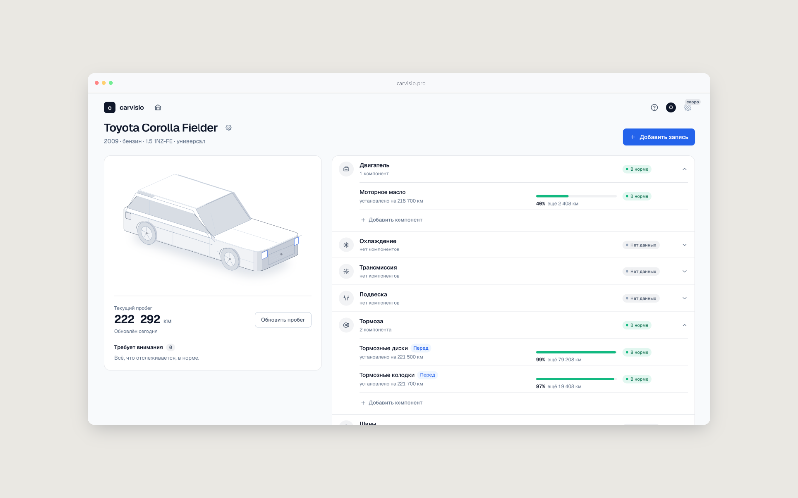

# carvisio 🚗

**Визуальный гараж для тех, кто помнит, когда менял масло. И для тех, кто не помнит.**

Carvisio помогает следить за состоянием автомобиля и хранить историю обслуживания в одном месте. Больше не нужно искать записи в заметках, вспоминать пробег последней замены или вести очередную таблицу в Excel.

Добавь автомобиль, укажи установленные компоненты и следи за их состоянием, ресурсом и историей обслуживания.

👉 **[carvisio.pro](https://carvisio.pro)**



## Возможности

- **Визуальный гараж.** Автомобиль представлен в виде интерактивной изометрической схемы. Можно выбирать отдельные системы и переходить к их компонентам.
- **Учёт компонентов.** Добавляй детали, расходники и другие элементы автомобиля, указывай пробег при установке и планируемый ресурс.
- **Контроль ресурса.** Carvisio рассчитывает оставшийся ресурс по пробегу и времени. Это ориентир для планирования обслуживания, а не диагностика фактического износа.
- **Ручная оценка состояния.** Можно отметить, что компонент требует внимания, даже если расчётный ресурс ещё не исчерпан.
- **История обслуживания.** Замены, ремонты, осмотры и другие работы с датой, пробегом, стоимостью и заметками. При замене компонента предыдущая запись сохраняется.
- **Несколько автомобилей.** Можно вести историю обслуживания всего гаража.
- **Без обязательной регистрации.** Начать пользоваться можно сразу. Данные гостевого режима хранятся локально; после регистрации их можно перенести в аккаунт и синхронизировать между устройствами.
- **Работа при нестабильном интернете.** Изменения сохраняются локально и синхронизируются с сервером при восстановлении соединения.

## Технологии

Проект состоит из двух частей:

**Frontend**
- Next.js
- React 19
- TypeScript
- Zustand
- SVG для интерактивной иллюстрации автомобиля

**Backend**
- Go
- PostgreSQL
- pgx

Frontend собирается в статические файлы, а backend предоставляет API для работы с данными и аккаунтами.

## Локальный запуск

Понадобятся Node.js, Go 1.26+ и Docker.

### 1. Запустить базу данных

```bash
docker compose up -d
```

### 2. Запустить API

```bash
cd server
cp .env.example .env
go run ./cmd/api
```

### 3. Запустить frontend

В другом терминале, из корня проекта:

```bash
npm install
npm run dev
```

Приложение будет доступно по адресу [http://localhost:3017](http://localhost:3017).

Для быстрого знакомства с интерфейсом можно открыть демо-режим:

[http://localhost:3017/?seed=demo](http://localhost:3017/?seed=demo)

В локальном режиме письма, например для сброса пароля, выводятся в лог API, а не отправляются получателю.

## Проверки

```bash
npx eslint .
npx tsc --noEmit

cd server
go vet ./...
go test ./...
```

## Структура проекта

```text
app/            Страницы приложения
components/     UI-компоненты
lib/            Состояние, API, синхронизация и расчёты
lib/iso/        Геометрия и отрисовка автомобиля
server/         Go API и миграции базы данных
deploy/         Файлы для развёртывания
```

---

Carvisio — небольшой проект, который вырос из простой идеи: было бы удобно иметь всю историю обслуживания автомобиля под рукой, а не вспоминать её каждый раз заново. 🔧